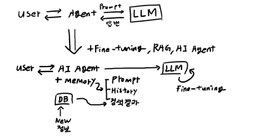

## LLM (Large Language Model)
```text
다음에 올 단어를 예측하기 위해 학습한 모델
    - 후보 단어들으 확률을 계산 -> 제일 높은 확률의 단어 출력
    -> 초기 LLM 작은 일 분담 ex) 스팸 분류, 번역, 요약
    ⬇️ 스케일이 확장

emergent abilities (창발)
    - 외국어 번역, 코드 작성,단계적 추론 등의 기술 생김
    -> LLM + 활용 ex) 챗봇, 검색, 코딩 등등 다양한 방면에서 활용

✔️ LLM 제작
    1) Pre-training (사전 학습)
    - 수조 단어를 읽으면 다음 단어 예측
    -> 기본 언어 능력
    2) SFT (Supervised Fine-Tuning / 지도 학습 미세 조정)
    - 사람이 작성한 질문, 답변 (모범데이터)로 대화 스타일 학습
    -> 대화형 비서
    3) RLHF (Reinforcement Learningfrom Human Feedback / 인간의 피드백)
    - 사람의 답변을 평가 -> 평가를 기반으로 모델 강화
    -> 안전하고 도움이 되는 AI
    
✔️ LLM의 활용
```

```text 
⚠️ LLM의 문제점
✔️ Hallucination (환각)
    - Model에 학습되지 않은 정보 (보지 못한 정보)에 대한 거짓 답변
    ex) 2025년에 학습된 모델에 2026년 dataset입력 -> error but 거짓 답변
✔️ domain (도메인)
    - 전문분야, 조직의 기밀, 보안에 대한 답변 불가
    ex) 학교 학생들의 성적 -> error
✔️ state less
    - 저장 메모리가 존재하지 않아 단순 답변만 가능


✅ 문제점 해결
    - 환각/ 도메인 문제해결
✔️LLM 전체 재학습 
    ❌ 비용(전기, GPU, 인력...), 시간 문제
    ⬇️
✔️ Fine - tuning (부분 재학습)
    -  오픈 소스로 제공된 model에 필요 정보만 추가 학습
    ❌ 비용, 성능(상용 LLM에 못미침), 계속된 정보 update, 환각 문제
    ⬇️
✔️ RAG
    - DB에서 관련 지식을 추출 후 LLM에 전달
    ❌ 검색 품질 = 답변 품질 (잘못된 검사 -> 잘못된 답변
         말투, 추론은 변경 불가
         긴 문서, 복잡한 이미지, 표 분석에 약함
         관계 없는 자료 인용 가능성
    ⬇️
✔️Fine-tuning + RAG 같이 사용

    - State less 문제 해결
✔️ AI agent 도입
    1) 계획 / 큰 목표 세분화
    2) 도구 / DB 검색, 계산 등 외부 자원 도출
    3) 메모리 / 이전 결과 저장
```
```text
기존 LLM
```

