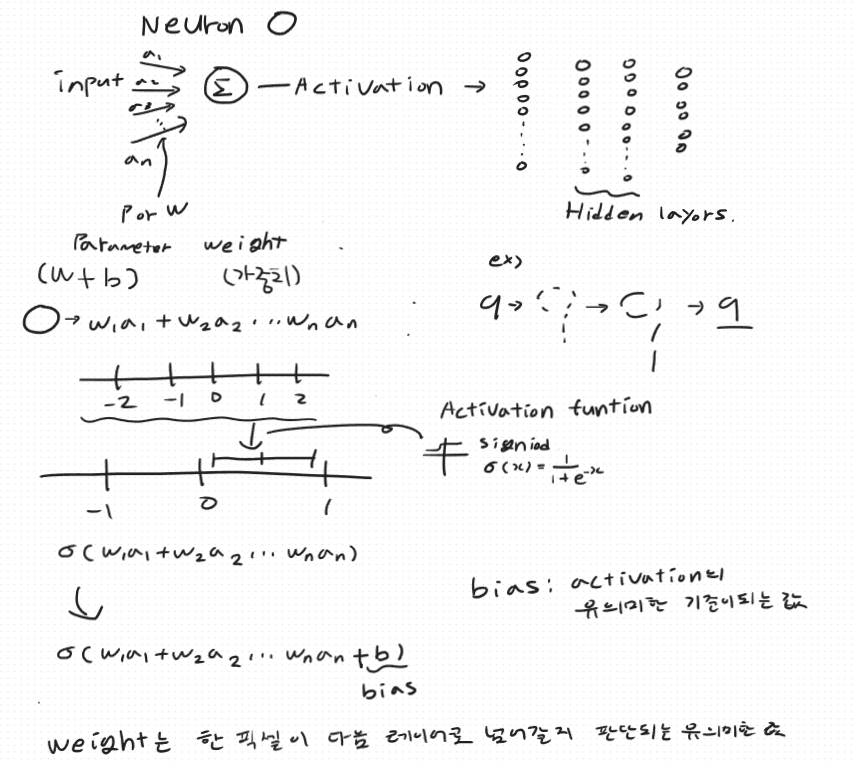

## Neuron
```text
하나의 신경 세포 / 뇌 정보처리의 기본 단위
        ○ 뉴런이 하는 일
            § 다른 뉴런으로부터 여러 신호 받기
            § 가중합 (신호 합치기)
            § 기준보다 크면 -> 다른 뉴런에 전달
            
    ➡️ 인공 뉴런으로 재현

✔️ Neuron 
    가중합 + 스위치

✔️ Weighted sum (가중합)
    입력값 x의 가중치의 총합
    z = w₁x₁ + w₂x₂ + w₃x₃ + b
    ✅ W (가중치) 
        ○ inputdata가 outdatad에 미치는 영향도, 중요도 
        ○ 기울기 (y값)
    ✅ b (Bias / 바이어스)
        ○ model이 기본적으로 가지는 성향을 조절
        ○ 좌 / 우 (x값)
    ✅ P (parameter / 파라미터)
        ○ w + b 값
        
✔️ activation (활성화 함수 / 스위치)
    parameter 값 (선형)을 비선형으로 변환하여 넘기는 함수
    y = activation(z)
            기준을 넘으면 on(1)
            기준을 넘지 못하면 off(0)
```
