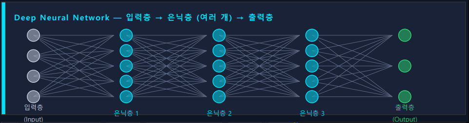

## Deep Learning
```text
ML 에서 학습 모델을 ANN(Artificial Neural Network / 인공 신경망)으로 구현
    
- 직선 그래프
H(x) = Wx + b 
✅ 기존 ML로 해결

- 곡선 그래프
기존 ML로 해결하기 위해 매번 문제에 맞는 수식 설계에 대한 한계
✅ANN -> DL 발전으로 해결


✔️ 단층 퍼센트론
    - 최초의 ANN
    - 이진 분류가 가능한 지도학습 알고리즘 / 도형 분류 문제
    
    ❌ 한계
        1) GPU 부재 (처리속도 ⬇️)
        2) 미숙한 학습 알고리즘 (XOR 해결 ❌) 
        3) 데이터 부족

✔️ Deep Learning (DL / 딥러닝)
```

```text
    - 신경망을 깊게 쌓게 복잡한 패턴 학습
  ⚠️ 과한 Hidden Layer (은닉층)
        ○ 기울기 소실 -> ReLU 함수로 해결
        ○ 과적합 -> Dropout 해결
        ○ 계산 복잡도, 비용 ⬆️

    ✅ 해결
        1) 연산량 폭증 ➡️ GPU 등장 (CPU = 직렬 / GPU = 병렬 연결 -> 처리 속도 ⬆️)
        2) 학습 방법 ➡️ Backpropugation (역전파)
        ✔️ Backpropugation (역전파)
            § 출력의 Loss(오차 측정) 후
            § 체인룰로 역행(거슬러 올라감)
            § 모든 가중치를 어느 방향, 얼마나 조정할지 한번에 계산
        3) 인터넷 발전 (다양하고 많은 data)
    
✔️ 추상화
    층을 쌓을 수록 층마다 의미 있는 표현을 학습
    ✅ 낮은 층 = 단순한 시각 단서 / 높은 층 = 의미 있는 개념
    
    
✔️DL의 학습
    학습 = 가중치 조정의 반복 (Backpropugation)
    
    
✔️ Neuron 구성에 따른 분류
    1) 이미지 -> CNN
    2) 순서가 있는 데이터 -> RNN / LSTM
    3) 텍스트, 멀티모달 -> Transformer

✔️LLM (Large Language Model
    다음에 올 단어 예측 기능으로 시작되어 다양한 기능까지 개발
```